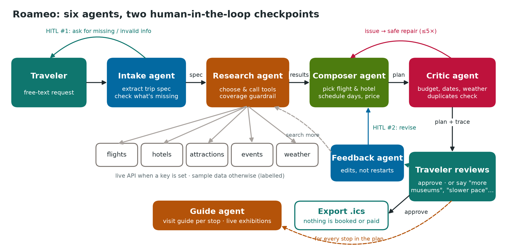
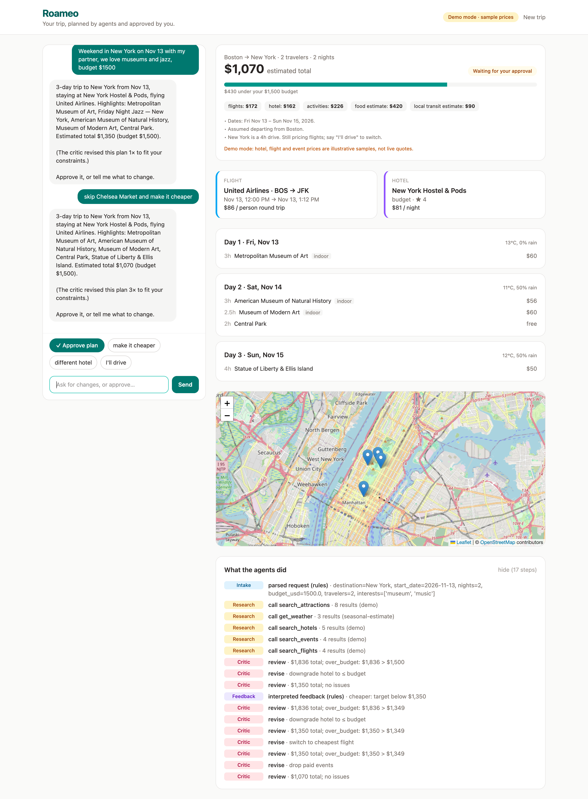
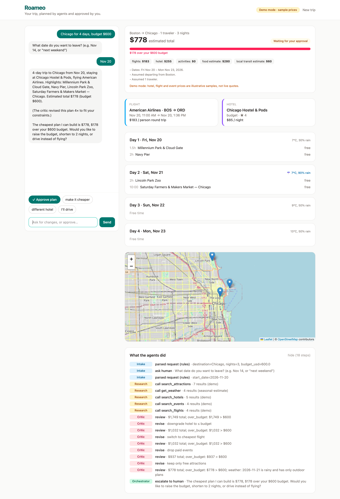

# Roameo: agents plan the trip, you make the call

Roameo is a multi-agent travel planner for short, budget-limited trips such as a student's weekend in New York.
You describe the trip in one sentence and get an hour-by-hour plan with each day's route on a map,
and a visit guide for every stop (what's on, what not to miss, how to spend your time there). A team of agents asks about anything missing, researches flights,
hotels, sights, events and weather, and builds a day-by-day plan. A critic agent checks the plan against
your budget. You get the final say: approve the plan, or ask for changes like *"cheaper"*,
*"different hotel"* or *"skip Alcatraz"*. Roameo **never books or pays for anything** on its own.



| Plan with agent trace | Over budget → asks the human |
|---|---|
|  |  |

## Quick start (about 3 minutes, no API keys needed)

```bash
# backend
cd backend
python3 -m venv venv && source venv/bin/activate
pip install -r requirements.txt
uvicorn app:app --port 8000 --reload

# frontend (new terminal)
cd frontend
npm install
npm run dev            # open http://localhost:5173
```

Without keys Roameo runs in **demo mode**. The agents and workflow are the same, but agents use rule-based
reasoning and tools return sample data (real landmark names; illustrative prices). The UI shows a
*"Demo mode · sample prices"* badge whenever this is the case.

### Live mode (optional)

Create `backend/.env` with any of the following. Each tool switches to live data independently.

```
OPENROUTER_API_KEY=...       # turns on the LLM agents (intake, tool-calling research, summaries)
LLM_MODEL=anthropic/claude-haiku-5.5   # optional, any OpenRouter model with tool calling
SERPAPI_API_KEY=...          # live Google Flights, Google Hotels and Google Events (free: 250 searches/month)
TICKETMASTER_API_KEY=...     # optional second events source, includes ticket prices (free)
GOOGLE_API_KEY=...           # optional: attractions via Places API (needs billing enabled)
```

One trip plan uses about 3 SerpApi searches (results are cached per session), so the free plan covers
roughly 80 plans a month. Weather comes from [Open-Meteo](https://open-meteo.com/), which needs no key. When the trip is more than 16
days away, a labelled seasonal estimate is used instead. If a live call fails, that tool falls back to sample data
and the result carries `source: "demo"`.

## Deploy a public demo (Render, free)

The `Dockerfile` builds the React app and serves it from the FastAPI backend, so the demo is one URL.

1. Push this repo to GitHub.
2. On [render.com](https://render.com), choose **New → Blueprint** and pick the repo. `render.yaml` sets everything up.
3. Fill in the secrets when asked: `OPENROUTER_API_KEY`, `SERPAPI_API_KEY`, and `ROAMEO_ACCESS_CODE`
   (visitors must enter this code, so nobody else can spend your API quota).
4. Open the URL Render gives you. The free plan sleeps after 15 minutes idle; open it a minute before a demo.

Each visitor is also limited to `ROAMEO_RATE_LIMIT` requests per hour (default 60).

## How it works

| Agent | Job | LLM mode | Demo mode |
|---|---|---|---|
| **Intake** (`agents/intake.py`) | Turn free text into a trip spec (destination, dates, nights, travelers, budget, interests, transport); decide what must be asked | LLM JSON extraction | Regex/rule parser |
| **Research** (`agents/research.py`) | Decide which tools a trip needs and call them, e.g. no flights for a road trip | Tool-calling loop (≤ 8 steps) + coverage guardrail | Rule policy |
| **Composer** (`agents/composer.py`) | Pick flight & hotel; hour-by-hour days with travel time between stops, meals, events, arrival and departure (rain → indoor first); price everything | Deterministic; LLM writes the summary | Deterministic |
| **Critic** (`agents/critic.py`) | Check budget, dates, duplicates, weather; choose the next safe repair | Deterministic | Deterministic |
| **Feedback** (`agents/feedback.py`) | Turn "more museums", "slower pace", "add the Guggenheim", "skip Alcatraz" into edit operations; send Research to search when more places are needed | LLM JSON + rules | Rules |
| **Guide** (`agents/guide.py`) | For every stop: what to see, how to spend the visit minute by minute, tips; for museums, current exhibitions **only from web search results**, with links | LLM + Google search (SerpApi) | Not available |
| **Orchestrator** (`agents/orchestrator.py`) | State machine, critic loop (≤ 5 repairs), human checkpoints, minimal revisions (keep existing stops, make room only when needed, report + / −) | Same | Same |

**Human-in-the-loop checkpoints**

1. **Before planning:** if the origin or destination is missing or unknown, or the date is missing or in the past, the agent asks instead of guessing.
2. **Before finishing:** every plan waits for approval. If the critic cannot fit the budget, it does not quietly
   exceed it. It shows the cheapest plan and asks you to choose: raise the budget, shorten the stay, or drive.

Money math and constraint checks are deliberately deterministic: an LLM should not be trusted to add up a budget.

## Evaluation

```bash
cd backend
ROAMEO_OFFLINE=1 ROAMEO_FORCE_DEMO=1 python -m eval.run_eval   # writes docs/evaluation_results.md
ROAMEO_OFFLINE=1 ROAMEO_FORCE_DEMO=1 pytest -q                 # same scenarios + API tests
python -m eval.run_eval --runs 3                               # with OPENROUTER_API_KEY: LLM mode, consistency
```

There are 18 scripted scenarios covering functional, end-to-end, human-in-the-loop, failure-handling and known-limitation cases.
Latest results: [demo mode](docs/evaluation_results.md) and [LLM mode, Claude Haiku 5.5, 3 runs per case](docs/evaluation_results_llm.md).

## API

| Method | Path | |
|---|---|---|
| `POST` | `/api/message` | `{message, session_id?}` → session state (status, spec, questions, plan, trace) |
| `GET` | `/api/guide?session_id=…&name=…` | Visit guide for one stop of the current plan |
| `GET` | `/api/export/{session_id}.ics` | Calendar file; only after the human approves |
| `GET` | `/api/health` | Which modes and tools are live |

## Known limitations

- Demo data covers 7 cities (New York, Chicago, Washington DC, Montreal, San Francisco, Boston, Philadelphia).
- The rule parser misses complex date phrases ("first weekend of December"); it asks for a date instead.
- Food and local transit are flat per-day estimates, not real prices.
- Sessions live in memory; restarting the backend clears them.
- The first prototype used Amadeus Self-Service for flights and hotels; Amadeus shut that portal down in July 2026, so
  live travel data now comes from SerpApi (Google Flights/Hotels/Events). Google Events rarely lists ticket prices,
  so those events show "price on site" and are not counted in the total.
- Live mode only knows airport codes for the 7 built-in cities; other cities fall back to sample flights.

## Project structure

```
backend/
  app.py              FastAPI endpoints + .ics export
  agents/             intake, research, composer, critic, orchestrator
  tools/              flights, hotels, attractions, events, weather (live + demo)
  fixtures/           demo-mode sample data
  eval/run_eval.py    scenario evaluation
  tests/              pytest
frontend/src/         React UI (chat, plan, map, agent trace)
docs/                 report, diagram, screenshots, evaluation results
```
